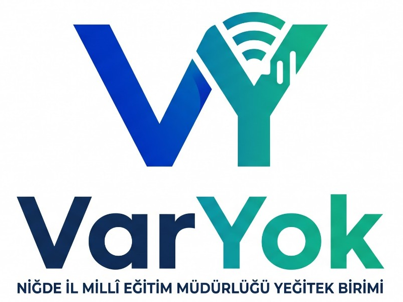

# VarYok



VarYok, okul yoklamalarını bilgisayarda tutmak üzere geliştirilen açık kaynaklı bir Windows masaüstü uygulamasıdır. Bu kaynak paketi 1.3 için geliştirme sürümüdür. Windows iş akışında EXE üretilmiş ve örnek verilerle açılış, hesap ve yoklama raporu test edilmiştir. **Okullardaki gerçek cihazlarda kurulum, kaldırma ve tüm arayüz akışları ile güvenlik ve hukuki değerlendirme henüz tamamlanmamıştır; üretim sürümü olarak dağıtmayın.**

Projenin önceki adı Dersteyim'di. Önceki masaüstü sürümünün veri klasörü bulunursa, yeni klasör henüz yokken mevcut kayıtlar olduğu yerde açılır; eski dosyalar silinmez. Giriş bilgileri de önceki klasörde kalmış olabilir. Her iki veri klasörü de varsa otomatik birleştirme yapılmaz; işlemden önce her iki klasörün güvenli yedeğini alın.

## Kullanım biçimi

- İlk açılışta kullanıcı kendi kullanıcı adını ve şifresini oluşturur. Okul talep formu, yetki dosyası ve ayrı yönetim aracı kullanılmaz.
- Uygulama kendi penceresinde açılacak şekilde hazırlanmıştır; Chrome sekmesi açılması amaçlanmaz. Arkada yalnızca aynı bilgisayardan erişilen bir yerel servis bulunur.
- Eğitim öğretim yılı otomatik önerilir; gelecek yıllar seçilebilir veya yazılabilir. Önceki yılların yoklamaları korunur. Öğrenci aktarımı otomatik değildir.
- Her bilgisayar kendi veritabanını tutar. Farklı bilgisayarlar otomatik eşitlenmez; bu sürüm ortak okul sunucusu değildir.
- E-posta ve push kodları korunur, okul modunda kapalıdır. İnternet, ücretli API, host ve domain günlük çalışma için gerekli değildir.
- e-Okul ile otomatik entegrasyon yoktur. Sınıf listesi ve ders programı XLSX veya CSV dosyasından aktarılır.

## Giriş bilgileri ve gizlilik

Kullanıcıların şifreleri istenen işleyiş gereği **Belgeler/VarYok** altında okunabilir TXT dosyalarında tutulur. Bu dosyaya ulaşabilen herkes ilgili hesaba girebilir. Bilgisayar hesabını ve diski koruyun; giriş bilgilerini, öğrencilerin verilerini ve veritabanı anahtarlarını GitHub'a yüklemeyin. Şifre dosyasında kullanıcı adı ve şifre görüntülenebilir. Uygulama giriş ekranındaki **Şifremi unuttum** düğmesi bu klasörü açmayı dener.

Bu uygulamanın kullanılması tek başına KVKK'ya uygunluk garantisi veya resmî uygunluk belgesi sağlamaz. Kullanıcı ve kurum gerekli idari ve teknik tedbirleri ayrıca değerlendirmelidir.

Veri envanteri, kuruma uyarlanacak aydınlatma taslağı ve bilinen riskler için [KVKK ve hukuk çalışma belgelerine](docs/kvkk/HUKUKI_DEGERLENDIRME.md) bakın. Gerçek verilerle kullanımdan önce özellikle düz metin şifre riski, kurumsal yetki ve veri sorumlusu değerlendirilmelidir.

## Yoklama dosyaları

Her kayıttan sonra Masaüstü/Yoklamalar altında ay ve gün klasörü oluşturulur. Örnek: `Yoklamalar/03-Kasım/04.11.2026/6-A_04.11.2026_09-15.xlsx`. Her Excel dosyası o sınıf ve gün için kaydedilmiş derslerde **gelmedi** durumundaki öğrencileri içerir; öğrenci adı maskelidir. Yeni kayıtlar daha önceki dosyaları silmez. Aynı dakika içinde dosya adı çakışırsa sıra numarası eklenir. Rapor oluşturulamazsa yoklama veritabanında kalır ve ekranda hata belirtilir.

## Geliştiriciler için

Derleme için Windows 10/11 x64, Node.js 24.x ve internet üzerinden ücretsiz bağımlılıkların edinilmesi gerekir. Windows 7/8 ve 32 bit için destek sağlanmamıştır. Yalnız uygulamanın günlük kullanımı çevrimdışıdır.

```powershell
npm ci
npm --prefix client ci
npm run build
npm test
New-Item -ItemType Directory -Force bin | Out-Null
Copy-Item (Get-Command node.exe).Source bin/node.exe
npm install --prefix desktop --no-audit --no-fund
npm --prefix desktop run dist
```

GitHub Actions iş akışı Windows üzerinde kurulum ve taşınabilir EXE üretir ve örnek verilerle temel çalışmayı sınar. Her değişiklikte ilgili işin sonucunu kontrol edin. Üretilmiş dosyalar, okul cihazlarında ve gerekli güvenlik ve kurum incelemelerinden sonra dağıtıma hazırlanmalıdır.

Bağımlılıkların yüksek ve kritik düzeyde bilinen açıklıkları için ayrı bir `npm audit` iş akışı vardır. Bu denetim uygulama kodu ve işletim sisteminin tamamına yönelik bağımsız güvenlik taramasının yerine geçmez; her işin sonucu ve ilgili commit kontrol edilmelidir.

Ayrıntılar: [Okul kullanım kılavuzu](docs/OKUL_KULLANIM.md) ve [geliştirme ve dağıtım notları](docs/GELISTIRICI_KILAVUZU.md).

## Lisans

Kaynak kodu için MIT lisansı öngörülmektedir; [LICENSE](LICENSE) ve [NOTICE](NOTICE) dosyalarına bakın. Kurum adı ve logosuyla yapılacak resmî yayım öncesinde hak sahipliği ve kurum içi izinler ilgili kurum tarafından doğrulanmalıdır. Üçüncü taraf bileşenler kendi lisanslarına tabidir.
